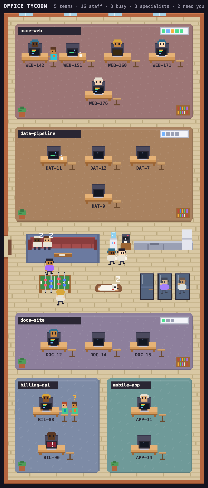

# Office Tycoon for Orca

Your coding agents, as tiny pixel staff in an office you can watch.


Office Tycoon is a plugin for [Orca](https://github.com/stablyai/orca), the desktop app for running
many coding agents in parallel git worktrees. It draws every agent on your machine, its SSH targets and the
Orca servers you paired, such as a cloud VM, as a little worker in an office, in the style of tycoon and office-sim games. You get a glance at who is busy,
who needs you and who is done, without having to click through every workspace.

## Install

Requires Orca 1.4.246 or newer.

In Orca, open Settings, then Plugins, and install Office Tycoon for Orca (`palulabs.office-tycoon`) from the
plugin directory. To run it from a clone instead:

```sh
git clone https://github.com/palulabs/orca-tycoon.git
cd orca-tycoon
orca plugin dev load .        # prints an approval; re-run with the --approve flag it shows
orca plugin open local.office-tycoon --panel office
```

The worker looks for the Orca CLI at `/Applications/Orca.app/Contents/Resources/bin/orca`, then
`~/Applications/...`, then `orca` on your `PATH`.

## Who works here

- **Projects are teams.** Each repository gets its own open area on the office floor. A big
  team spreads across the full width; small ones share the floor in two columns.
- **Agents get desks.** Every agent has a seat with a monitor facing you. A worktree's child
  worktrees sit right next to it, so a stack of branches reads as one row of desks. The nameplate
  under a desk is the ticket key or issue number in the agent's conversation or workspace name,
  else the workspace name. Only when that name is generic, like `main` or a name several desks
  share, does the first word of the conversation title take its place, so four desks on `main`
  still tell apart.
- **Subagents are specialists.** Every desk has a stool at its end, the second seat. When an
  agent calls in a subagent, a specialist walks in through the front door in the side wall, sits on that stool
  leaning in toward the screen, and leaves the same way when the job is done. A desk grows up to
  three stools and shows a `+` on the last one beyond that. The badge on a specialist's shirt is coloured by role,
  the same across the whole office.
- **Idle agents take a break.** A band across the middle of the floor holds the commons: a lounge
  with a sofa, the coffee corner and kitchen, a foosball table and calling booths. Agents that are
  done, idle, or waiting on background tasks walk over and pick something to do. Every minute
  each one draws a new activity on a rhythm of its own, so they never all move at once: a nap on
  the sofa (done and idle agents only), a coffee or a book on the sofa, a mug at the coffee corner,
  a game of foosball (always two players, one on each long side), or a call in a booth. When a
  place is full they take their next choice, and when everything is full they stay at their desk.
  When an agent gets new work, it walks back and sits down.
- **Palú is the office dog.** A white, fluffy, long and low bichon with a little stub of a tail
  and a red collar. He wanders the floor, sniffs the plants, the bookshelves and the corners of
  the furniture, visits his food and water bowls, naps in his bed in the commons, and now and
  then lies down in front of someone's desk for a nap, more often beside someone who is dozing
  too. Click him while he rests and he gets up and goes on to whatever he does next. He is only
  there for company and never changes what anyone does.
- **Agents speak up.** When an agent finishes, a speech bubble shows the first line of its last
  reply. When one starts waiting for you it says "Need you!", and when it gets stuck it says
  "Stuck!".

A status line along the top counts teams, staff, busy agents and how many need you.

## Two looks

The switch in the top right corner picks how the office looks, and the panel remembers it. The
office opens in the Loft until you pick Brick.

- **Loft** shows the office from the front and above, like a doll's house with its front wall
  taken off. It is set up like a real office in an old concrete hall: tall steel windows onto a garden
  at the far end, each team in a room closed off by navy curtains, and the hangout in the middle with
  phone booths, a coffee counter, a sofa on a pink rug, foosball and a high table.
- **Brick** is the flat office seen from straight above, as in the screenshot below and the
  pictures further down.



In the loft, every worktree of a project owns a desk, also while it sleeps: then its chair stays
empty and its nameplate is dimmed. A project shows up as soon as one of its worktrees has a live
agent. Desks stand in islands of six that stay put while seats empty and fill; a project with three
worktrees or fewer gets half an island, one row of three, and two such projects share a room, each
island under its project's name. The front row sits with their backs to you, their screens facing you
and the nameplate on the back of the chair. The back row faces you over their monitors, the nameplate
on the back of the monitor below a status light. A desk keeps its place until its worktree goes,
nobody moves up, and a new worktree takes the first free desk, beside its parent when that one is
free. Specialists sit on an orange stool right beside their agent, two at most, with a `+` for more.
The loft's hangout adds one thing to do on a break: a chat at the round white table, two or more
round it taking turns to talk, never one alone.

## Reading the monitors


| Agent state | What you see |
| --- | --- |
| working | typing, code scrolling on screen |
| watching background tasks | on a break in the commons, never napping |
| waiting for you | amber `?` on screen |
| blocked | red flashing screen with `!` |
| done | on a break in the commons, often napping; dozing at the desk with a `z` when the commons are full |

Hover over a desk, a person or Palú for a card with who it is, where they sit and what they are
doing; it follows them if they walk off. Click anyone, at their desk or on a break, and they tell you in one line what they are doing:
"I'm editing panel.js", "I'm watching CI run", "I'm waiting on the reviewer". The line comes from
the tool and input Orca already reports, so no model is asked. A specialist tells you the job it
was called in for. The side panel shows the worktree, state, task, current tool and specialists,
and its Open in Orca button brings the agent's terminal tab to the front. A Chat UI session has no
terminal tab, so for one the button shows its worktree instead, as clicking it in the sidebar does.
Clicking a person or a desk never moves Orca's focus; only the button does. An agent on a paired
Orca server sits with the team of its project at a thin client: a pale terminal with a slim box
beside it whose light blinks while it works. The side panel names the server it runs on.
If a server cannot be reached, only its desks go missing until it answers again.


## How it works

Orca's plugin API (`agents.list`) only lists the agents of the focused workspace, and it has no
subagents. To see the whole office, the worker (`src/worker.ts`) runs `orca worktree ps --json`
instead. Orca's own sidebar and phone app draw from the same rows. The worker trims them to a small
office model (`src/protocol.ts`): projects, seats, and each seat's specialists.

The panel (`src/panel.html`, `src/panel.js`, `src/sprites.js`, and `src/loft.js` for the loft) polls the worker every 3 seconds,
the same rate Orca's phone app uses, and draws one canvas at 8 frames a second. Every sprite is
drawn in code, so the plugin loads no assets and makes no network requests. The office fills the
panel: it is drawn at the biggest whole pixel scale at which the whole building fits, and the
corridors between rooms widen so the bottom wall reaches the panel's bottom edge. Only an office
too crowded to fit at the smallest scale scrolls.

### Permissions

Because the worker runs the Orca CLI, the plugin needs the `trusted-worker` execution profile. It
asks for no other capabilities.

## Develop

```sh
orca plugin validate .
orca plugin test .            # ps rows to the office model, and the loft's seats and floor plan
orca plugin dev reload .      # after editing; the panel redraws
orca plugin shot local.office-tycoon --panel office --out shot.png
```

At the top of `src/panel.js`, `AWAY_STATES` and `LOUNGE_STATES` decide which states send an agent
on a break, and `ACTIVITIES` lists what they can do there, with a weight for how often each comes
up. Add `waiting` to `AWAY_STATES` if you'd like agents that wait for you to take a break too.

The screenshots in `docs/` show a made-up office, rendered from the real panel code.

## License

[MIT](LICENSE)

Office Tycoon for Orca is a community plugin and is not affiliated with Orca or Stably.

Palú, the office dog, is named after the bichon who gave Palu Labs its name. In loving memory,
2003 to 2018.
